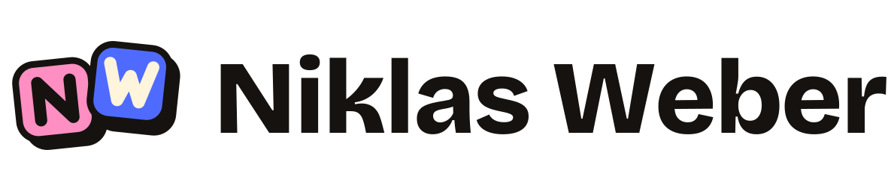

<div align="center">

<picture>
  <source media="(prefers-color-scheme: dark)" srcset="brand/nw-lockup-horizontal-on-dark.svg">
  
</picture>

# nweber.me

**Portfolio of Niklas Weber — systems developer.**
A playful sticker-style site: flat colour sheets, thick outlines, hard shadows and letter tiles that drop, roll and tumble as you scroll.

[](https://nweber.me)
[](https://github.com/nweber23/my_website/actions/workflows/deploy.yml)
[](LICENSE)


</div>

---

## Highlights

- **Scroll-driven motion.** Lenis inertial scrolling drives GSAP ScrollTrigger timelines; nearly everything is tied to scroll progress.
- **Sticker motion.** The name is a row of letter tiles that drop in and fall off; BUILD, BREAK and REBUILD roll through one set of tiles; text strips are slapped on and lean with scroll speed; the about cards can be dragged around.
- **miniRT Studio.** A scene builder and live ray tracer in raw WebGL2 (see [below](#minirt-studio)).
- **Writing.** Technical posts on systems programming, graphics and distributed systems, with EN/DE switching.
- **Accessible.** `prefers-reduced-motion` removes pins, drops and dragging in favour of a plain stacked layout.
- **No framework.** Vanilla TypeScript, hand-written CSS, self-hosted fonts.

## Design

Warm paper (`#FFF4DC`) with loud flat sheets: yellow `#FFD23F`, pink `#FF8FC2`, blue `#4F6BFF`, green `#5BE3A1`, lilac `#C3A6FF`, and ink `#16120F` for thick outlines and hard shadows. Type is Bricolage Grotesque with JetBrains Mono for labels, both self-hosted through Fontsource.

The logo is two tilted letter tiles, a pink N and a blue W. The full kit (SVGs, favicons, one-colour and on-dark versions, lockups, guide) is in [`brand/`](brand/), and `brand/build_logo.py` regenerates it. Usage rules are in [`brand/LOGO-GUIDE.md`](brand/LOGO-GUIDE.md).

<details>
<summary><b>Motion system, section by section</b></summary>

1. **Loader** — yellow screen with a live `BOOTING n%` counter; the name fills with ink as the page loads.
2. **Header** — sticker chips: brand with the logo mark, a nav pill whose pink fill follows the section in view, location and language switch.
3. **Hero** — the name is a row of letter tiles that drop in with a bounce, hop away from the pointer and fall off the screen, fanning out, as you scroll.
4. **Build / Break / Rebuild** — one row of tiles where each tile is a small reel: the letters roll from BUILD to BREAK, the tiles drift apart, then drift back and roll into REBUILD.
5. **Text rows** — tilted tape strips that are slapped onto the page, slide along as you scroll and lean with scroll speed.
6. **About** — three loose cards that drop in and can be dragged with momentum.
7. **Projects** — a sticky photo pile: the current project's photo lies on top, earlier ones stay underneath.
8. **Index & field notes** — every case study as an expandable sticker row.
9. **Video** — the demo plays in a sticker window with a quote and a turning wheel of tech tags.
10. **Footer** — the name pops up letter by letter.

</details>

## miniRT Studio

[`/minirt-studio.html`](https://nweber.me/minirt-studio.html) is a scene builder and live ray tracer for the 42 miniRT project, written in TypeScript and WebGL2. Spheres, planes, capped cylinders, cones and point lights are placed with the mouse and traced per pixel in a fragment shader (ambient light, Phong shading, hard shadows, optional mirrors and checkerboards).

| | |
|---|---|
| **Editing** | Select, move, resize and aim with on-canvas handles; numeric inspector; undo/redo, duplicate, snap. Orbit, pan and zoom, including touch. |
| **Files** | Import and export standard `.rt` files (`A`, `C`, `L`, `sp`, `pl`, `cy`, plus `co` for cones). Bad lines are skipped and listed, never fatal. |
| **Sharing** | Whole scene in the URL (deflate + base64url) with size caps on link and decompressed data. PNG export at 1920 px. |
| **Limits** | 24 spheres, 8 planes, 16 cylinders, 8 cones, 8 lights, 8 mirror bounces. |

<details>
<summary><b>Conventions, modules and caveats</b></summary>

- Left-handed like most miniRT builds (facing +Z, +X right, +Y up); colours are clamped linear values with no gamma; horizontal field of view; cylinder and cone positions are the middle of the axis.
- Mirrors, checkerboards, specular settings and bounce depth are studio-only and are not written to `.rt` files. Cones export as `co x,y,z axis diameter height r,g,b` with `x,y,z` at the base centre; check that your parser agrees.

| File | Role |
|------|------|
| `scene.ts` | Scene model, limits, validation of untrusted data |
| `rt.ts` | `.rt` parser and writer |
| `renderer.ts` | WebGL2 program and the ray tracing shader |
| `pick.ts`, `view.ts`, `math.ts` | CPU intersection for picking, camera projection, vector helpers |
| `viewport.ts` | Render loop, orbit/pan/zoom, handles, pointer input |
| `inspector.ts`, `main.ts` | Property panels, dialogs, toolbar, keyboard shortcuts |
| `store.ts`, `share.ts`, `presets.ts` | Undo history, link encoding and storage, starter scenes |

The CPU intersection code in `pick.ts` must stay in step with the shader, since selection uses it. Camera moves are a view change and stay out of undo.

</details>

## Tech stack

| Layer | Technologies |
|-------|--------------|
| Frontend | HTML, CSS, TypeScript, GSAP (ScrollTrigger, Draggable, Inertia), Lenis, raw WebGL2 for miniRT Studio |
| Build | Vite (multi-page), self-hosted fonts via Fontsource |
| Serving | nginx in a multi-stage Docker image, behind a host reverse proxy with Let's Encrypt TLS |
| CI/CD | GitHub Actions deploys to a VPS over SSH on every push to `main` |

## Getting started

Requires Node 20.19+ (22 recommended, see `.nvmrc`).

```bash
npm install
npm run dev        # http://localhost:5173
npm run build      # type-check + production build into dist/
npm run preview    # serve dist/
```

## Deployment

Pushing to `main` runs [`.github/workflows/deploy.yml`](.github/workflows/deploy.yml), which SSHes into the VPS and rebuilds the container. The deploy key is restricted server-side to a single forced command (`git pull && docker compose up -d --build`), and the workflow pins the server's host key fingerprint.

Required repository secrets: `VPS_HOST`, `VPS_USER`, `VPS_SSH_KEY`.

To run it manually on any Docker host:

```bash
cp .env.example .env     # set DOMAIN_NAME
docker compose up -d --build
```

See [docs/DEPLOYMENT.md](docs/DEPLOYMENT.md) for nginx, TLS and reverse-proxy details.

## Project structure

```
├── index.html            # Home: sticker system, projects, writing, about, contact
├── writing.html          # Writing index
├── writing/              # Posts
├── projects/             # Project case-study pages
├── imprint.html          # Legal notice
├── minirt-studio.html    # miniRT Studio
├── src/
│   ├── main.ts           # Home entry: loader, Lenis, ScrollTrigger timelines
│   ├── pages.ts          # Entry for writing/imprint pages
│   ├── i18n/             # EN/DE dictionary
│   ├── poster/           # Halftone image used in the About section
│   ├── shared/           # Clock, GitHub stats
│   ├── studio/           # miniRT Studio
│   └── styles/           # base, home, pages, project, studio
├── brand/                # Logo kit: SVGs, favicons, guide, generator script
├── public/               # Copied as-is: assets, favicons, manifest, robots.txt, sitemap.xml, llms.txt
├── nginx/                # nginx server configuration
├── Dockerfile            # Build + serve image
└── docker-compose.yml
```

## License

[MIT](LICENSE)
